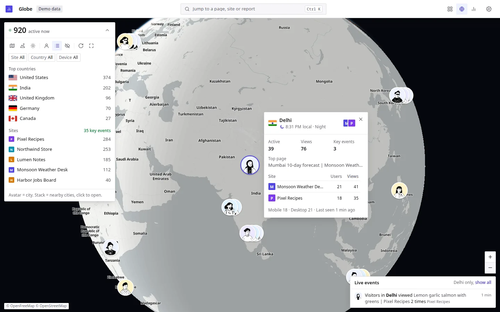
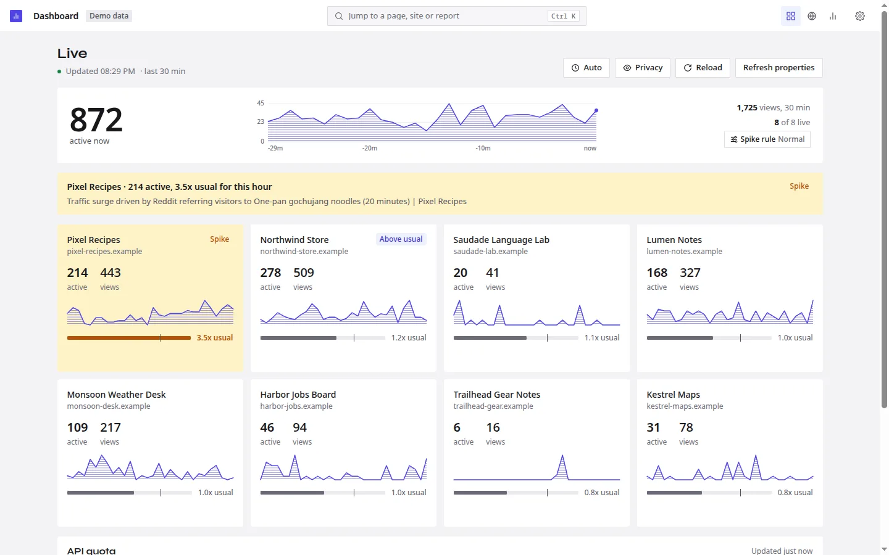
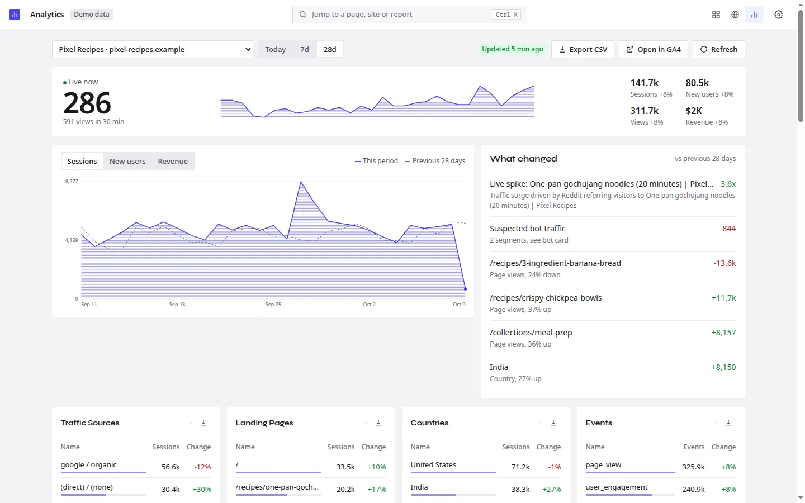
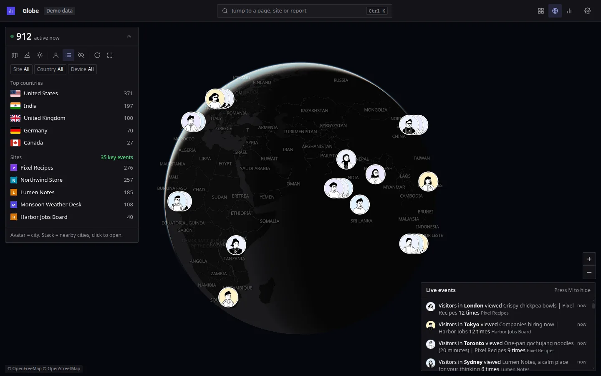

# GA4 Dashboard

Real-time Google Analytics 4 (GA4) dashboard with a live globe, traffic spike detection, visitor insights, and a Model Context Protocol (MCP) server for AI assistants.



<details>
<summary>More screenshots</summary>

<table>
<tr>
<td width="33%"></td>
<td width="33%"></td>
<td width="33%"></td>
</tr>
<tr><td>Home</td><td>Analytics</td><td>Globe, dark theme</td></tr>
</table>

Screenshots use demo mode (generated data, fictional sites).

</details>

---

## Features

- **Real-time Analytics Dashboard**: Live active user monitoring, property comparison, traffic recipes, and quota tracking.
- **Live Globe**: Shows live visitors as avatars on a MapLibre globe (or a flat map), with city cards, day and night shade, and a live event feed.
- **Spike Detection**: Automatically detects sudden traffic surges and classifies traffic sources (referral, direct, campaign).
- **Visitor Insights**: Aggregates persona cards for new vs. returning visitors, device breakdowns, and top geography.
- **MCP Server**: Query GA4 properties, funnels, and reports from AI tools (Claude Code, Claude Desktop, Cursor). It lives in `mcp-server/` and shares the root `.env` and `pnpm install`.
- **Privacy Shield**: Redacts full URL parameters and query strings to prevent private data leakage on dashboards.
- **Smart Caching & Quota Protection**: Disk + in-memory caching layers with automatic background property metadata updates to preserve GA4 API quota.
- **Setup page**: Until credentials work, every page opens `/setup`: a prompt for your AI agent and a live checklist that moves on as each step passes.

---

## Prerequisites

- **Node.js**: v22 or higher
- **Package Manager**: [`pnpm`](https://pnpm.io/) (one install at the root covers the dashboard and the MCP server)
- **Google Cloud Platform (GCP) Account**: access to create a Service Account with Google Analytics API permissions

---

## Setup

Full steps, the agent prompt and the manual path: [SETUP.md](SETUP.md).

### Quick start

```bash
git clone https://github.com/TheTechBasket/GA4_report.git
cd GA4_report
pnpm install
cp .env.example .env
pnpm start
```

Open [http://localhost:5483](http://localhost:5483). It opens `/setup`: copy the prompt into your AI agent (Claude Code, Codex, Gemini CLI). The agent creates a Google Cloud service account and fills `GA4_CLIENT_EMAIL` and `GA4_PRIVATE_KEY` in `.env`. The checklist updates every 3 seconds, no restart needed. The last step is yours: add the service account email as **Viewer** in GA4 Admin, Account access management.

Check from the terminal at any time:

```bash
pnpm setup:check
```

### Demo

No Google account needed:

```bash
pnpm demo
```

Generated data for 8 fictional sites. A "Demo data" badge shows in the bar.

### Run with Docker

Fill `.env` first (see Quick start), then:

```bash
docker run -d --name ga4-dashboard --env-file .env -p 127.0.0.1:5483:5483 ghcr.io/thetechbasket/ga4-dashboard:latest
```

Or with the compose file in this repo:

```bash
docker compose up -d
```

The image has no credentials in it. It reads them from env. Add `-e DEMO=1` instead of `--env-file .env` to try demo mode. Run the MCP server from the same image with `docker run --rm -i --env-file .env ghcr.io/thetechbasket/ga4-dashboard:latest node mcp-server/index.js`.

### MCP server

The MCP server in `mcp-server/` reads the same `.env`. Register it with Claude Code from the project you want it in:

```bash
claude mcp add ga4 --scope project -- node <path>/mcp-server/index.js
```

Use `--scope user` to have it in every project. The `/setup#ai` page has a prompt for other AI tools and the tool list. Run it by hand with `pnpm mcp`. Tool details: [mcp-server/README.md](mcp-server/README.md).

### Hosting publicly

The app has no login. Anyone who can reach it sees your GA4 data. Run it on localhost, or put it behind Cloudflare Access or Tailscale before you expose it. With Docker, publish port 5483 on localhost only (`-p 127.0.0.1:5483:5483`) and let the proxy or tunnel reach it there. See Private access below.

### Private access

Both setups reach the app on `127.0.0.1:5483` and open no public port on your server.

**Cloudflare Tunnel plus Access.** Needs a domain on Cloudflare.

```bash
cloudflared tunnel login
cloudflared tunnel create ga4-dashboard
cloudflared tunnel route dns ga4-dashboard ga4.example.com
```

`~/.cloudflared/config.yml` (use the tunnel UUID that `create` printed):

```yaml
tunnel: <Tunnel-UUID>
credentials-file: /home/<user>/.cloudflared/<Tunnel-UUID>.json
ingress:
  - hostname: ga4.example.com
    service: http://127.0.0.1:5483
  - service: http_status:404
```

Test with `cloudflared tunnel run ga4-dashboard`, then run it as a service:

```bash
sudo cloudflared --config /home/<user>/.cloudflared/config.yml service install
sudo systemctl start cloudflared
```

Then add a login in front. In Zero Trust, add the One-time PIN identity provider (Integrations, Identity providers). Then add a self-hosted application for `ga4.example.com` (Access controls, Applications) with an Allow policy for your email addresses. Visitors get a code by email before they see the dashboard.

Docs: [create a tunnel](https://developers.cloudflare.com/cloudflare-one/networks/connectors/cloudflare-tunnel/do-more-with-tunnels/local-management/create-local-tunnel/), [config file](https://developers.cloudflare.com/cloudflare-one/networks/connectors/cloudflare-tunnel/do-more-with-tunnels/local-management/configuration-file/), [run as a Linux service](https://developers.cloudflare.com/cloudflare-one/networks/connectors/cloudflare-tunnel/do-more-with-tunnels/local-management/as-a-service/linux/), [self-hosted Access app](https://developers.cloudflare.com/cloudflare-one/access-controls/applications/http-apps/self-hosted-public-app/), [One-time PIN](https://developers.cloudflare.com/cloudflare-one/integrations/identity-providers/one-time-pin/).

**Tailscale.** Only devices on your tailnet can open it.

```bash
curl -fsSL https://tailscale.com/install.sh | sh
sudo tailscale up
sudo tailscale serve --bg 5483
```

It serves at `https://<machine>.<tailnet>.ts.net` (HTTPS certificates must be on for your tailnet) and stays on after reboot. `tailscale serve reset` turns it off. Do not use Funnel for this app: Funnel makes the URL public, and the app has no login.

Docs: [install on Linux](https://tailscale.com/kb/1031/install-linux), [Tailscale Serve](https://tailscale.com/kb/1312/serve), [`tailscale serve` reference](https://tailscale.com/kb/1242/tailscale-serve).

---

## Testing & building

```bash
pnpm test   # run the unit test suite (mocha)
pnpm build  # TypeScript compilation check
```

---

## License

Distributed under the [MIT License](LICENSE). See `LICENSE` for more information.

---

## Author

**Amit Yadav**
- GitHub: [@TheTechBasket](https://github.com/TheTechBasket)
- Repository: [https://github.com/TheTechBasket/GA4_report](https://github.com/TheTechBasket/GA4_report)
